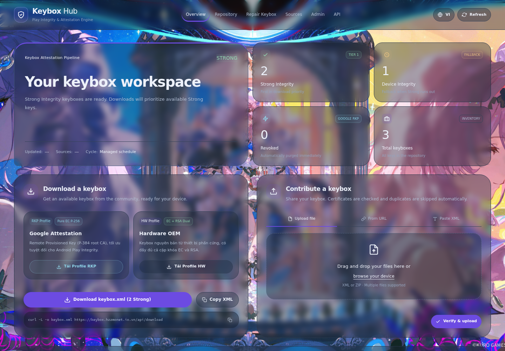
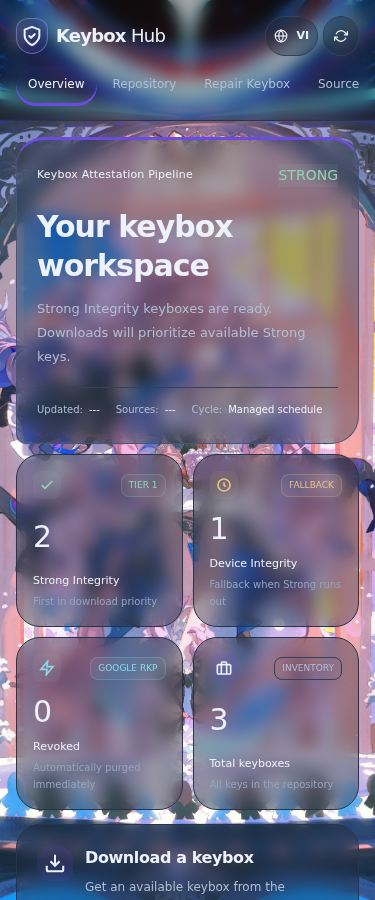

# Keybox Hub

Kho keybox với kiểm tra chuỗi chứng chỉ, ưu tiên RKP, sửa XML và giao diện responsive.

## Preview

Ảnh chụp giao diện với dữ liệu minh họa, không chứa thông tin đăng nhập hoặc keybox thật.

### Desktop


### Mobile


## Chạy dự án

Yêu cầu Node.js 22+.

```bash
npm ci
cp .env.example .env
# Điền KEYBOX_ADMIN_PASSWORD trong .env trên máy chủ, không commit file này.
node --env-file=.env src/server.js
```

Mặc định server lắng nghe tại `127.0.0.1:8098`; dùng reverse proxy để phục vụ HTTPS. Chỉ proxy loopback được tin cậy khi xác định IP. File trong `data/` được tạo khi chạy; SQLite, mật khẩu, token và cấu hình riêng không được đưa vào phiên bản hiện tại.

## Quản trị

Mở `/admin`, đăng nhập bằng mật khẩu quản trị. Phiên bearer chỉ giữ trong bộ nhớ trang, hết hạn sau 8 giờ hoặc khi restart.

- Quản lý keybox, nguồn, lịch kiểm tra/quét/làm mới trình duyệt và rate limit theo IP.
- Chọn theme, màu nhấn, độ đặc thẻ 0–100%, độ tối nền 0–100%, blur 0–100px.
- Background desktop/mobile riêng, ảnh hoặc video, poster và nhạc nền. Nhạc cần tương tác của người xem.
- Media hỗ trợ URL HTTPS hoặc tài nguyên trong `/images/`. Ảnh nền nằm tại [`public/images/bg.jpg`](public/images/bg.jpg), dùng đường dẫn `/images/bg.jpg`. Bản quyền hình thuộc chủ sở hữu gốc; chuyển từ ảnh nền đang dùng, không xác lập quyền sở hữu hình.
- Lưu cấu hình Webhook/Telegram chung **không gửi tin thử**. Cấu hình gửi riêng theo token đã tắt; token cũ vẫn dùng cho xác thực API.
- Token API được cấp và thu hồi trong quản trị, chỉ hiển thị nguyên giá trị lúc cấp.

Cấu hình riêng lưu tại `data/notification-settings.json` và `data/site-settings.json`, quyền 0600, được bỏ qua trong Git. Mật khẩu dùng scrypt, token truy cập lưu dạng hash. Giữ kín file cấu hình vì thông tin kênh gửi cần được lưu để sử dụng.

### Nguồn cộng đồng

Người xem có thể thêm nguồn HTTPS ngay trên trang chủ, **không cần đăng nhập**. Thêm nguồn không quét ngay; giới hạn theo IP áp dụng để giảm lạm dụng. Sửa, xóa, bật/tắt và quét thủ công vẫn yêu cầu quản trị.

### API chính

| API | Quyền | Công dụng |
| --- | --- | --- |
| `GET /api/status` | Công khai | Trạng thái và metadata keybox |
| `GET /api/download?profile=rkp` | Công khai | Tải theo profile; hỗ trợ `hw`, `id` |
| `POST /api/upload`, `/api/repair` | Công khai, giới hạn IP | Kiểm tra/tải lên và sửa XML |
| `GET/POST /api/sources` | Công khai, POST giới hạn IP | Danh sách/thêm nguồn |
| `GET /api/site-settings` | Công khai | Giao diện/media và chu kỳ trình duyệt |
| `POST /api/notifications/admin/login` | Mật khẩu | Tạo phiên quản trị |
| `GET/PUT /api/admin/settings` | Admin | Cấu hình website |
| `GET/PUT /api/admin/notifications` | Admin | Kênh thông báo chung, che secret |
| `/api/admin/keys`, `/api/admin/sources` | Admin | Quản lý keybox/nguồn |
| `POST /api/admin/check-now`, `/api/admin/loot` | Admin | Kiểm tra/quét thủ công |
| `/api/notifications/admin/subscriptions` | Admin | Cấp/danh sách/thu hồi token API |
| `POST /api/report` | Token API hoặc admin | Báo trạng thái keybox |

API bảo vệ dùng `Authorization: Bearer <token>`. Các endpoint cấu hình/thử thông báo của subscriber cũ trả về `410`.

## Thông báo và bot

Thông báo chung được cấu hình trong `/admin`; không tự lấy đích gửi từ môi trường hay subscriber cũ. Sự kiện gồm `keybox.added`, `keybox.banned`, `keybox.status_changed`. Payload thông báo chỉ chứa metadata, không chứa XML, private key hoặc IP. Gửi nền có timeout; không có hàng đợi lưu bền hoặc retry.

Bot Telegram tải keybox là module riêng: ưu tiên `TELEGRAM_BOT_TOKEN` trong môi trường, sau đó token bot của subscriber cũ nếu có. Bot hỗ trợ `/status`, `/list`, `/keybox`, `/help`. Long polling có thể khởi động cùng dịch vụ nếu đã cấu hình token; không bật trên môi trường kiểm thử với thông tin thật.

## Kiểm thử

```bash
npm test
```

Không chạy test với thông tin kênh gửi production. API test dùng dữ liệu tạm và giả lập mạng; kiểm tra phạm vi cô lập của các test khác trước khi chạy trên máy chủ đang phục vụ.

## Dữ liệu đã được theo dõi trước đây

SQLite/WAL và trust cache được bỏ khỏi phiên bản hiện tại nhưng vẫn có thể tồn tại trong lịch sử Git cũ. Không xem thao tác ignore/untrack là xóa lịch sử hoặc thu hồi thông tin đã công khai. File runtime trên máy chủ không bị xóa.
